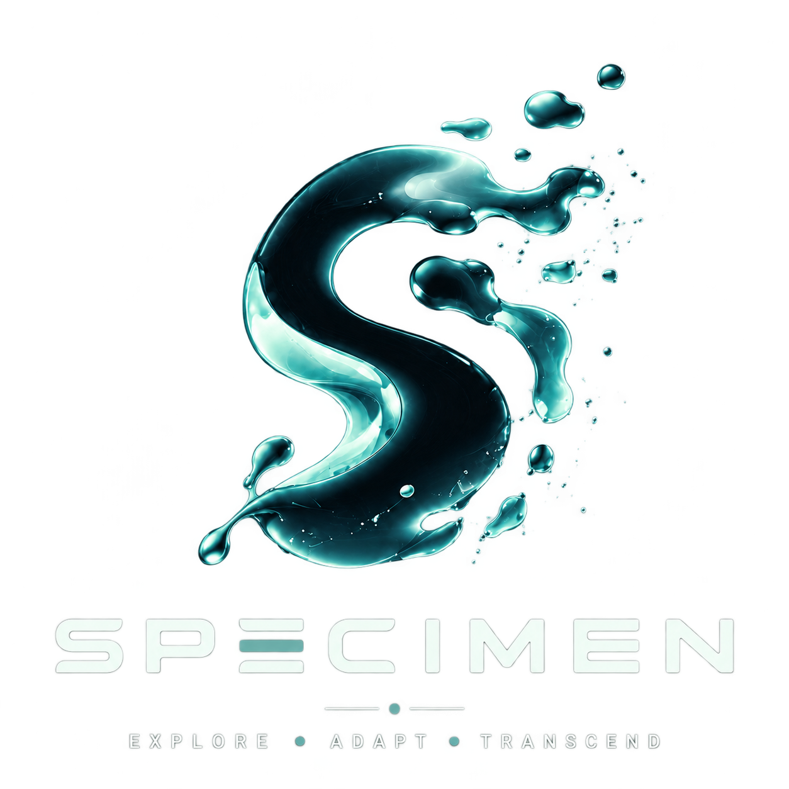

<h1 align="center">
  
</h1>

<p align="center">
  <strong>Escape was never part of the experiment.</strong>
</p>

<p align="center">
  <a href="https://github.com/Gradient-Ascenders/Specimen/actions/workflows/submission-build.yml"></a>
  <a href=".nvmrc"></a>
  <a href="package.json"></a>
  <a href="package.json"></a>
</p>

<p align="center">
  <a href="#quick-start">Quick start</a> ·
  <a href="#build-and-check">Build and check</a> ·
  <a href="docs/README.md">Documentation</a>
</p>

**Specimen** is a single-player 3D puzzle-platformer set in an abandoned biological
research facility. Switch between three slime bodies and combine their abilities
to escape through **Containment**, **Cultivation** and **Blackout**.

| Specimen | Ability |
| --- | --- |
| **Bob** | Stick, climb and launch powerful charged bounces. |
| **Goop** | Dissolve marked geometry to open new routes. |
| **Volt** | Illuminate dark spaces and power electrical machinery. |

Inactive bodies stay where you leave them: hold a pressure plate, complete a
circuit or light a route while controlling another slime.

Built with **TypeScript, Three.js and Vite**, with custom GLSL shaders and
Blender/GLB assets.

## Quick start

Use **Node.js 24.14.1** and **npm 11.18.0**. The commands below use nvm; if Node.js
is already installed at the required version, skip `nvm use`.

```bash
git clone https://github.com/Gradient-Ascenders/Specimen.git
cd Specimen
nvm use
npm install --global npm@11.18.0
npm ci
npm run dev
```

Open the local URL printed by Vite in a browser with WebGL 2 support.

Choose **Start trial** to begin the story, or **Select level** on the main menu
to enter Containment, Cultivation or Blackout. Later levels start with the
specimens needed for their puzzles.
Use **Return to menu** in the pause menu to end the current trial and choose again.

**Default controls:** WASD to move, mouse to look, Space to jump, Tab to switch
specimens and P to pause. Change bindings in Settings. Press **F1** to toggle the
[HUD](docs/architecture/clean-gameplay-mode.md) while keeping aiming overlays.

## Build and check

| Command | Purpose |
| --- | --- |
| `npm test` | Run unit tests. |
| `npm run build` | Type-check and build the static site into `dist/`. |
| `npm run preview` | Serve the production build locally. |
| `npm run validate:production` | Check the built layout and asset references. |
| `npm run test:smoke` | Check startup, menus, restarts and level loading at a nested URL. |
| `npm run archive` | Build and validate `artifacts/specimen-production.zip`. |

Before running smoke tests, build the game and install Chromium once with
`npx playwright install chromium`. See the [CI guide](docs/operations/continuous-integration.md)
for deeper browser checks and required PR checks.

To publish, upload the **contents of `dist/`** to the static host, with `index.html`
at the site root. Relative asset paths also support hosting under a subdirectory.
A ZIP upload alone does not publish the game; follow the
[deployment guide](docs/operations/deployment.md) for packaging and verification.

## Documentation

- [Project docs](docs/README.md) — architecture, levels and design decisions.
- [Slimes and abilities](docs/gameplay/slimes-and-abilities.md) — switching and gameplay mechanics.
- [Playtesting](docs/operations/playtesting.md) — checks for a complete playthrough.
- [Gameplay audio](docs/architecture/gameplay-audio.md) — sound mapping and asset provenance.
