# Level 3 polish visual evidence

These are game-canvas captures from the approved refinement passes. They use
normal exposure and reproducible survey cameras. Drone views use the room's
powered light banks; tunnel views use Volt's existing navigation light. No
temporary inspection lights or production debug globals are included.

The wall-junction pair uses identical camera positions and game lighting.
Other images show the approved final appearance; they are not before/after
comparisons. Browser journeys stage body positions to exercise interactions,
rather than completing an uninterrupted playthrough.

| Area | Evidence |
| --- | --- |
| Half-submerged dormant Bob-side drone | 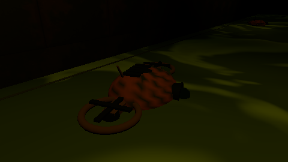 |
| Narrow route-focused scan | 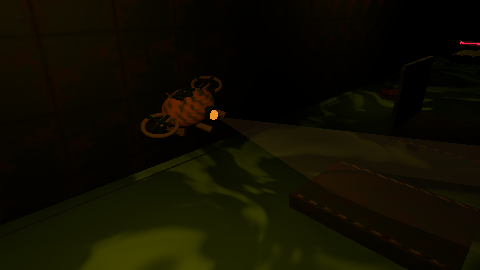 |
| Third drone beside Volt's catwalk, dormant | 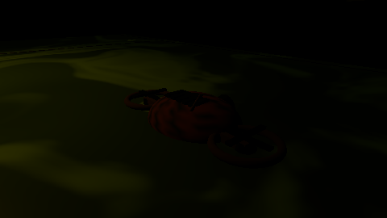 |
| Third drone guarding the catwalk | 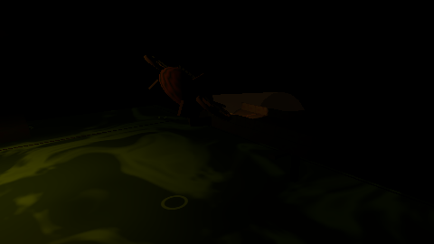 |
| Catwalk end, duplicate faces removed | 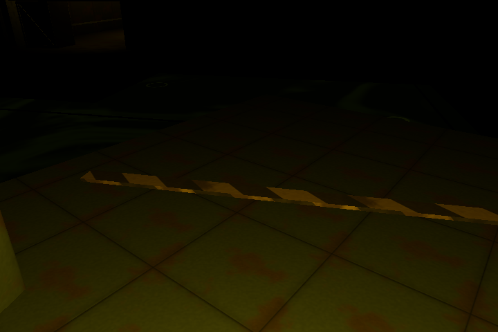 |
| Deployed bridge join, looking back | 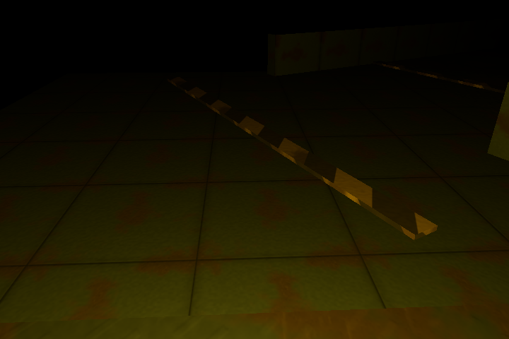 |
| Recessed tunnel entrance | 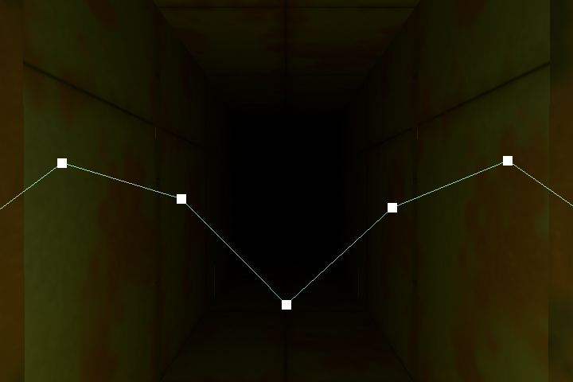 |
| Clean tunnel corner | 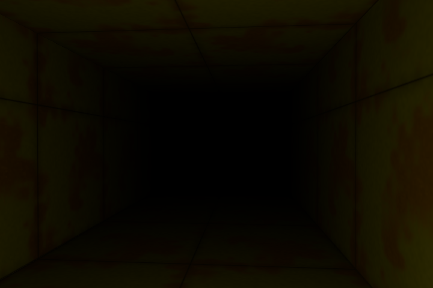 |
| Wall junction before final correction | 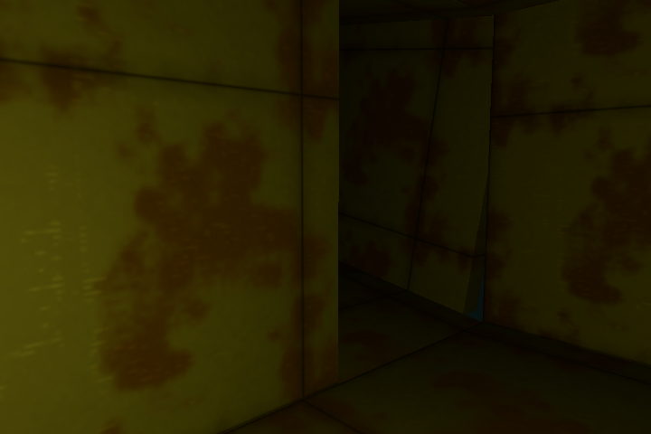 |
| Same wall junction after correction | 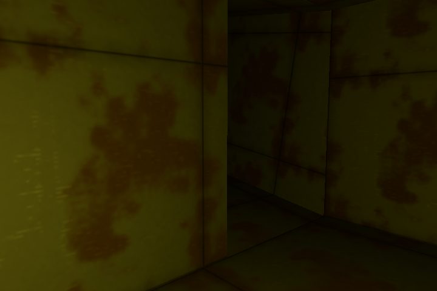 |
| Flush hazard strip on the Room 1 floor | 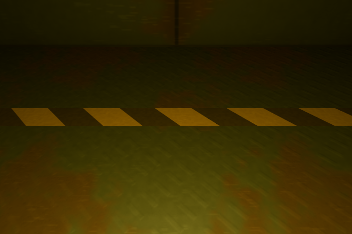 |

Additional front/low/reverse junction views, tunnel outlet views, floor-lip
views and machine-readable browser results are generated locally under ignored
`artifacts/evidence/`. Reproduce with the browser commands in
[the final review](../../level-3-polish-review.md).
