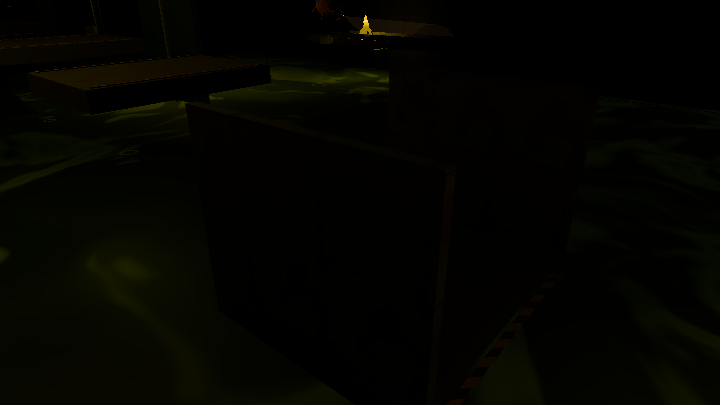
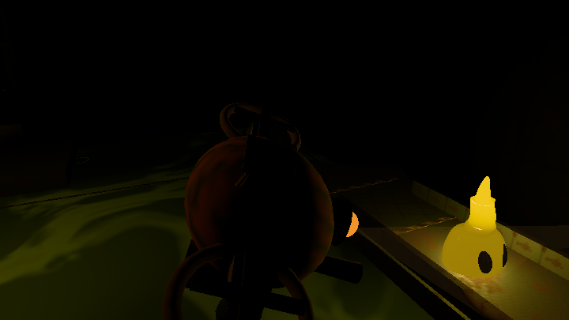
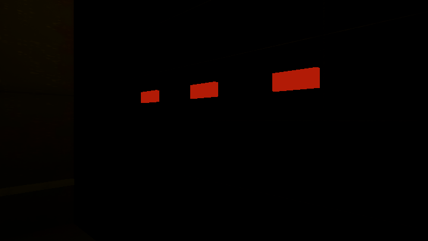
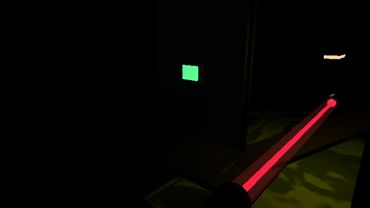
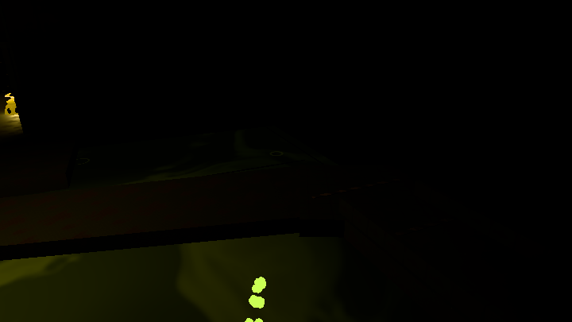
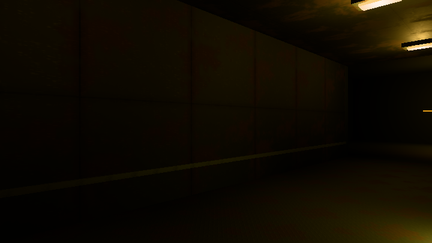

# Mandatory drone encounter evidence

Production Chromium captures use normal game lighting and exposure. Camera
surveys stage authored body positions; real controllers, collision bodies,
acid projectiles and hostile projectiles perform the checked interactions.
They are repeatable encounter checks, not an uninterrupted playthrough.

| Situation | Capture |
| --- | --- |
| Widened normal surveillance beam covering Bob's route |  |
| Bob's lift remains unpowered while its guard lives |  |
| Volt's bridge remains retracted while guards live |  |
| Physical hallway shutter before destruction |  |
| Half-submerged guard during emergence |  |
| First guard redirects its beam and fires at Goop |  |
| Second guard redirects its beam and fires at Goop |  |
| West guard retaliates toward Goop's basin firing position |  |
| Bob can operate the bridge switch after the guards are destroyed |  |
| The same Volt crossing after Goop destroys the guards |  |
| The same hallway view with the security shutter released |  |

The closed/open Volt and hallway pairs use identical survey cameras. Tests also
assert real projectile hits on Goop, physical blocking before clearance, Bob and
Volt walking through afterward, and locked/open checkpoint recovery.

Reproduce with:

```text
npm run build
npx playwright test tests/smoke/EmergingSewerDrones.spec.ts --config playwright.smoke.config.ts --grep "mandatory drone"
```

Additional machine-readable results and logs are ignored local artifacts:
`artifacts/evidence/batch-3-drone-refinement/mandatory-encounter-results.json`
and `test-results/mandatory-*.log`.

See [implementation and validation](../../mandatory-drone-encounter.md).
