# Room 2 local encounter evidence

These production Chromium captures use the existing game lighting and exposure.
Tests stage the beginning of each protected section, then use real bodies,
collision, acid hits, electrical tethers and machinery. They do not represent
an uninterrupted full-level playthrough.

| Encounter | Guard alive | Guard destroyed and original machinery used |
| --- | --- | --- |
| Bob's first lift | 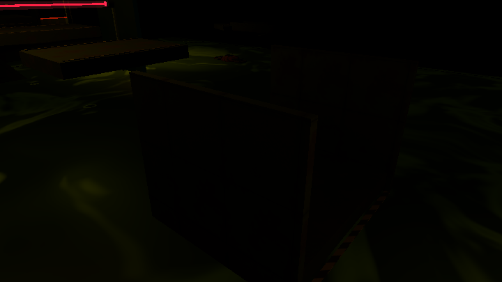 | 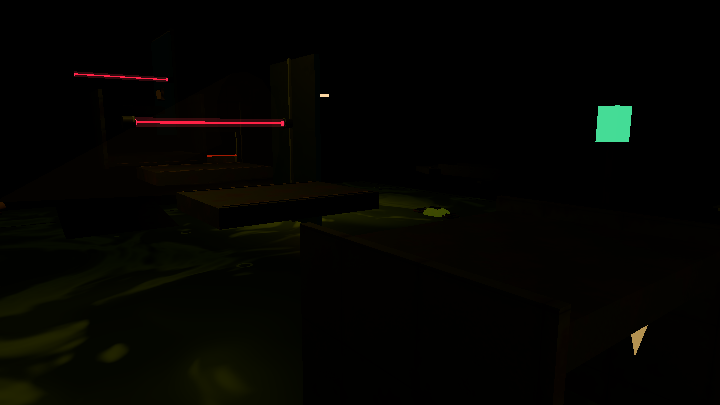 |
| Bob's second lift | 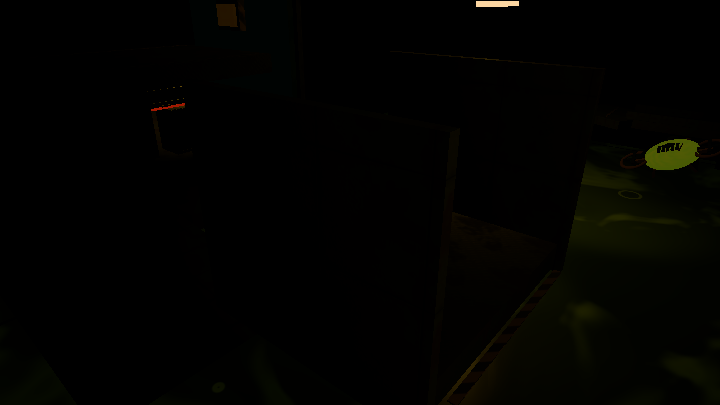 | 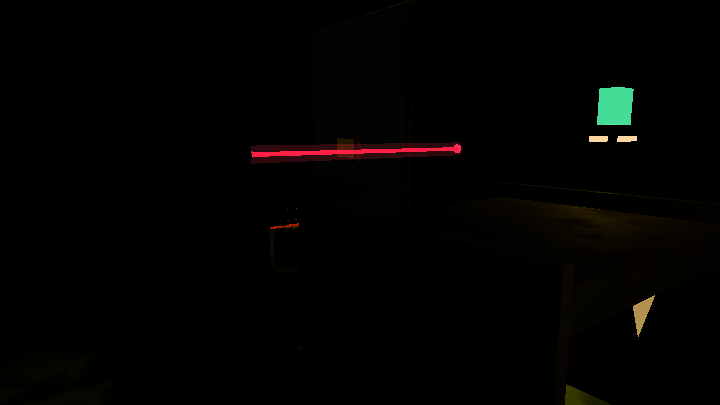 |
| Volt's bridge | 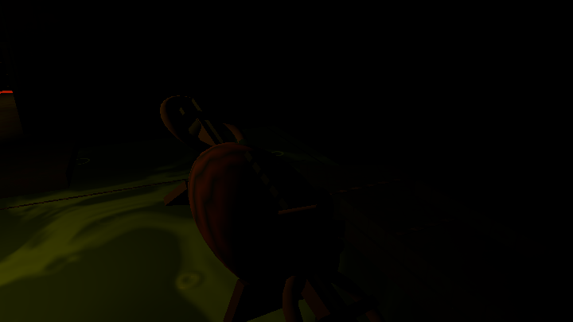 | 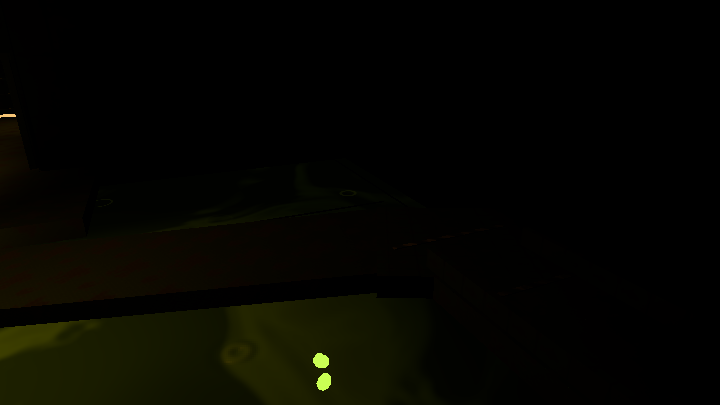 |

The machine-readable browser results record running, charged-jump, edge-jump,
sticky-wall and emergence attempts; actual Volt lift tethers; Bob's carried
height and subsequent landing; and Volt crossing and powering the bridge lock.
The first guard's destruction does not release the second lift. Guard destruction
makes machinery available without performing its electrical/cooperative step.

| Preserved combat / original exit | Capture |
| --- | --- |
| Normal widened surveillance | 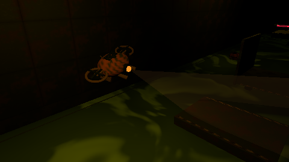 |
| Half-submerged emergence | 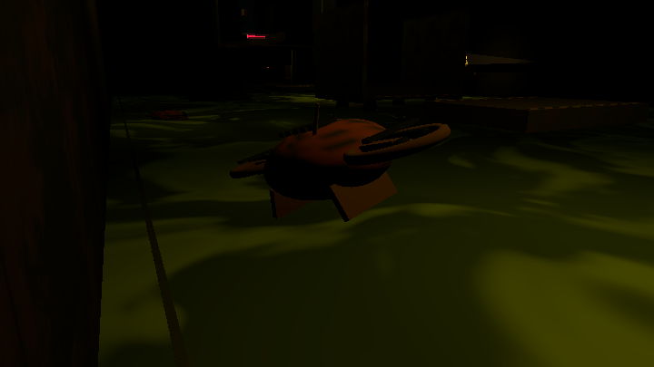 |
| Goop retaliation, first guard | 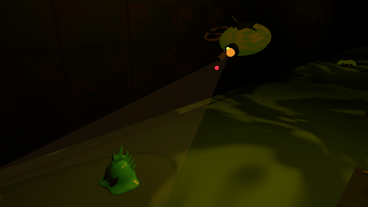 |
| Goop retaliation, second guard | 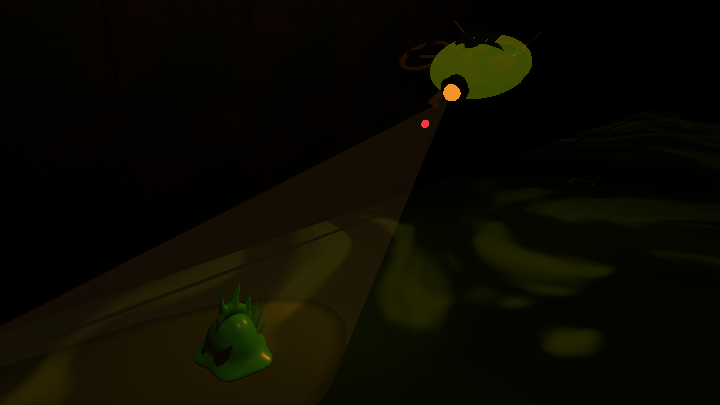 |
| Goop retaliation, west guard | 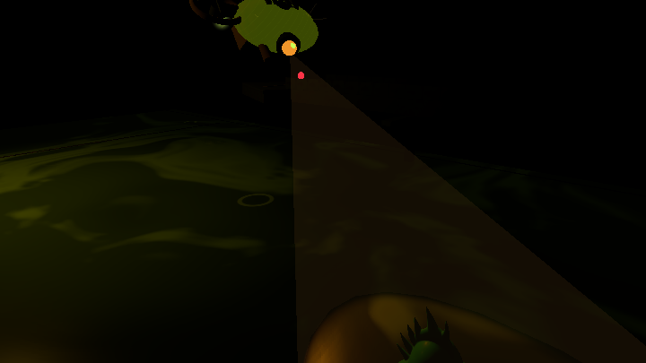 |
| Original hallway, no added barrier even with living guards | 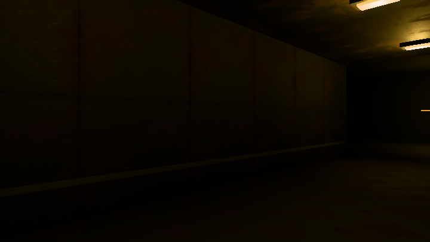 |

The approved combat captures remain valid: retaliation presentation is unchanged.
Obsolete exit-barrier captures are removed. No inspection lights or production
debug globals are added. Separate browser checks drive lethal real projectile
hits on Bob/Volt and click the actual Retry button.

Reproduce after `npm run build`:

```text
npx playwright test tests/smoke/EmergingSewerDrones.spec.ts --config playwright.smoke.config.ts
```

Ignored local results: `artifacts/evidence/batch-3-drone-refinement/local-route-results.json`
and `test-results/local-*.log`.

[Mechanics, validation and local test steps](../../mandatory-drone-encounter.md).
